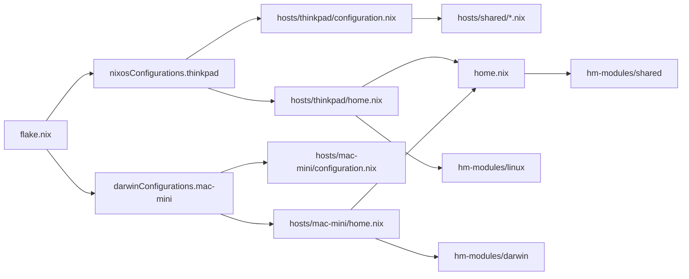

# NixOS + nix-darwin

**Language:** [Polski](README.md) · English

> Two machines, one declarative configuration: a **ThinkPad T490** running
> NixOS and a **Mac mini M4** running macOS. Shared Home Manager, separate
> system modules.

[](https://nixos.org/)
[](https://github.com/nix-darwin/nix-darwin)
[](https://github.com/YaLTeR/niri)
[](https://noctalia.dev/)

## Table of contents

- [Hosts](#hosts)
- [Stack](#stack)
- [How it works](#how-it-works)
- [Wallpapers](#wallpapers)
- [Quick start](#quick-start)
- [Documentation](#documentation)
- [Repository layout](#repository-layout)
- [Rules](#rules)
- [Links](#links)

## Hosts

| Host | System | Nix | Environment | GUI | Documentation |
|---|---|---|---|---|---|
| `thinkpad` | NixOS `nixos-unstable` (`x86_64-linux`) | upstream Nix | Home Manager + niri + Noctalia | nixpkgs | [hosts/thinkpad](hosts/thinkpad/README.en.md) |
| `mac-mini` | macOS 27 (`aarch64-darwin`) | Determinate Nix | Home Manager + nix-darwin | Homebrew casks | [hosts/mac-mini](hosts/mac-mini/README.en.md) |

## Stack

| Layer | Technology |
|---|---|
| System | [NixOS](https://nixos.org/) / macOS + [nix-darwin](https://github.com/nix-darwin/nix-darwin) |
| Management | [Nix flakes](https://nix.dev/concepts/flakes) |
| User environment | [Home Manager](https://github.com/nix-community/home-manager) |
| GUI packages | nixpkgs (Linux) / [Homebrew casks](https://brew.sh/) (macOS) |
| Compositor | [niri](https://github.com/YaLTeR/niri) (ThinkPad only) |
| Shell / UI | [Noctalia](https://noctalia.dev/) (ThinkPad only) |
| Bootloader | systemd-boot (ThinkPad) |
| Filesystem | btrfs; LUKS prepared for a future reinstall |
| Formatting | [alejandra](https://github.com/kamadorueda/alejandra) |

## How it works



`home.nix` is the shared Home Manager base. Everything that works on both
systems lives in `hm-modules/shared`; Linux-only modules live in
`hm-modules/linux`, macOS-only modules in `hm-modules/darwin`. This lets
`nix flake check` evaluate both hosts without trying to build niri on Darwin
or dconf on macOS.

## Wallpapers

Both hosts use the
[revaljonathan/wallpapers](https://github.com/revaljonathan/wallpapers)
repository as the `wallpapers` flake input (`flake = false`). Images are
linked individually into `~/Pictures/Wallpapers`; about 800 MB is not copied
into your home directory.

```console
nix flake update wallpapers   # refresh wallpapers
```

The first `nix flake lock` downloads roughly 800 MB. User directories are in
English: `~/Downloads`, `~/Documents`, `~/Pictures`, `~/Videos`, `~/Music`.

> The repository has no LICENSE file — use the wallpapers privately and check
> the rights before republishing.

## Quick start

| Goal | Linux | macOS |
|---|---|---|
| Switch the system | `make update` | `make mac` |
| Build without activating | `make test` | `make mac-build` |
| Roll back | — | `make mac-rollback` |
| Check the flake | `make check` | `make check-all` |
| Format | `make fmt` | `make fmt` |

After changing `inputs` in `flake.nix`, refresh the lockfile:

```console
nix flake lock
```

Full setup guides:

- **ThinkPad:** [hosts/thinkpad/README.en.md](hosts/thinkpad/README.en.md)
- **Mac mini:** [hosts/mac-mini/README.en.md](hosts/mac-mini/README.en.md)

## Documentation

| Document | Contents |
|---|---|
| [hosts/thinkpad/README.en.md](hosts/thinkpad/README.en.md) | NixOS, niri, Noctalia, shortcuts, hardware, maintenance |
| [hosts/thinkpad/INSTALL.en.md](hosts/thinkpad/INSTALL.en.md) | ThinkPad reinstall with LUKS and disko |
| [hosts/mac-mini/README.en.md](hosts/mac-mini/README.en.md) | macOS from scratch, casks, defaults, permissions, troubleshooting |
| [docs/architecture.en.md](docs/architecture.en.md) | Flake, Home Manager split, adding a host |
| [docs/fish.en.md](docs/fish.en.md) | Fish, plugins, fzf, zoxide, fisher |
| [docs/glossary.en.md](docs/glossary.en.md) | Glossary: flake, cask, TCC, SIP, etc. |

Polish versions: [README.md](README.md), [docs](docs/), [hosts](hosts/).

## Repository layout

<details>
<summary>Show the directory tree</summary>

```text
.
├── README.md
├── README.en.md
├── flake.nix
├── flake.lock
├── home.nix                     # shared Home Manager base
├── Makefile
├── docs/
│   ├── architecture.md / .en.md
│   ├── fish.md / .en.md
│   └── glossary.md / .en.md
├── hosts/
│   ├── shared/                  # NixOS-only
│   │   ├── system.nix
│   │   ├── users.nix
│   │   └── desktop.nix
│   ├── thinkpad/
│   │   ├── README.md / .en.md
│   │   ├── INSTALL.md / .en.md
│   │   ├── configuration.nix
│   │   ├── home.nix
│   │   ├── hardware.nix
│   │   ├── hardware-configuration.nix
│   │   └── disko.nix
│   └── mac-mini/
│       ├── README.md / .en.md
│       ├── configuration.nix
│       ├── home.nix
│       ├── homebrew.nix
│       └── defaults.nix
├── hm-modules/
│   ├── shared/                  # fish, git, direnv, neovim, Zed, CLI, wallpapers
│   ├── linux/                   # gtk/dconf, XDG, niri, Noctalia
│   └── darwin/                  # fish PATH, Ghostty, fastfetch
└── scripts/
    └── noctalia-export.sh
```

</details>

## Rules

- **Single source of truth:** configuration lives in git, not in the UI.
  Manual slider changes are overwritten by the next `darwin-rebuild` for keys
  managed by Nix.
- **CLI from Nix, GUI from casks:** on macOS, terminal tools come from
  nixpkgs and windowed apps from Homebrew.
- **Shared stays shared:** `hm-modules/shared` must not import Linux-only or
  macOS-only modules.
- **Manual exceptions are documented:** Apple Watch unlock, Control Center
  layout, App Store apps — see
  [hosts/mac-mini/README.en.md](hosts/mac-mini/README.en.md).
- **No secrets:** the repo contains no keys or tokens.

## Links

- [NixOS options](https://search.nixos.org/options)
- [Home Manager options](https://home-manager-options.extranix.com/)
- [nix-darwin options](https://nix-darwin.github.io/nix-darwin/manual/)
- [Determinate Nix](https://docs.determinate.systems/determinate-nix/)
- [niri wiki](https://yalter.github.io/niri/)
- [Noctalia docs](https://docs.noctalia.dev/)
- [disko](https://github.com/nix-community/disko)
- [nix-direnv](https://github.com/nix-community/nix-direnv)
- [Tailscale](https://tailscale.com/)
