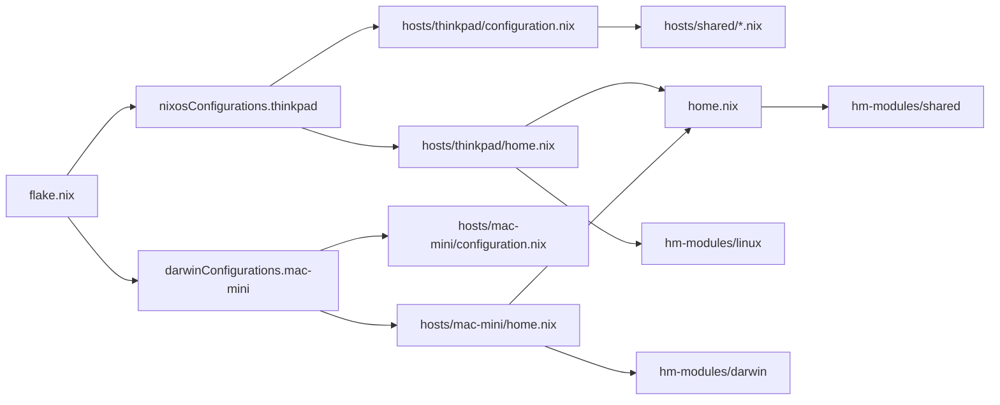

# NixOS + nix-darwin

**Język:** Polski · [English](README.en.md)

> Dwie maszyny, jedna deklaratywna konfiguracja: **ThinkPad T490** z NixOS
> i **Mac mini M4** z macOS. Wspólny Home Manager, osobne moduły systemowe.

[](https://nixos.org/)
[](https://github.com/nix-darwin/nix-darwin)
[](https://github.com/YaLTeR/niri)
[](https://noctalia.dev/)

## Spis treści

- [Hosty](#hosty)
- [Stack](#stack)
- [Jak to działa](#jak-to-działa)
- [Tapety](#tapety)
- [Szybki start](#szybki-start)
- [Dokumentacja](#dokumentacja)
- [Struktura repo](#struktura-repo)
- [Zasady](#zasady)
- [Linki](#linki)

## Hosty

| Host | System | Nix | Środowisko | GUI | Dokumentacja |
|---|---|---|---|---|---|
| `thinkpad` | NixOS `nixos-unstable` (`x86_64-linux`) | upstream Nix | Home Manager + niri + Noctalia | nixpkgs | [hosts/thinkpad](hosts/thinkpad/README.md) |
| `mac-mini` | macOS 27 (`aarch64-darwin`) | Determinate Nix | Home Manager + nix-darwin | Homebrew casks | [hosts/mac-mini](hosts/mac-mini/README.md) |

## Stack

| Warstwa | Technologia |
|---|---|
| System | [NixOS](https://nixos.org/) / macOS + [nix-darwin](https://github.com/nix-darwin/nix-darwin) |
| Zarządzanie | [Nix flakes](https://nix.dev/concepts/flakes) |
| Środowisko użytkownika | [Home Manager](https://github.com/nix-community/home-manager) |
| Pakiety GUI | nixpkgs (Linux) / [Homebrew casks](https://brew.sh/) (macOS) |
| Kompozytor | [niri](https://github.com/YaLTeR/niri) (tylko ThinkPad) |
| Shell / UI | [Noctalia](https://noctalia.dev/) (tylko ThinkPad) |
| Bootloader | systemd-boot (ThinkPad) |
| System plików | btrfs; LUKS przygotowany pod reinstalację |
| Formatowanie | [alejandra](https://github.com/kamadorueda/alejandra) |

## Jak to działa



`home.nix` to wspólna baza Home Managera. Wszystko, co działa na obu systemach,
żyje w `hm-modules/shared`; rzeczy tylko linuksowe w `hm-modules/linux`,
a tylko macOS-owe w `hm-modules/darwin`. Dzięki temu `nix flake check` nie
próbuje zbudować niri na Darwinie ani dconf na Macu.

## Tapety

Oba hosty korzystają z repo
[revaljonathan/wallpapers](https://github.com/revaljonathan/wallpapers) jako
flake input `wallpapers` (`flake = false`). Obrazy są linkowane pojedynczo do
`~/Pictures/Wallpapers` — nie kopiujemy ~800 MB do katalogu domowego.

```console
nix flake update wallpapers   # aktualizacja tapet
```

Pierwsze `nix flake lock` pobiera ok. 800 MB. Katalogi użytkownika są po
angielsku: `~/Downloads`, `~/Documents`, `~/Pictures`, `~/Videos`, `~/Music`.

> Repo nie zawiera pliku LICENSE — używaj tapet prywatnie i sprawdź prawa
> przed publikacją.

## Szybki start

| Cel | Linux | macOS |
|---|---|---|
| Przełącz system | `make update` | `make mac` |
| Zbuduj bez aktywacji | `make test` | `make mac-build` |
| Rollback | — | `make mac-rollback` |
| Sprawdź flake | `make check` | `make check-all` |
| Formatowanie | `make fmt` | `make fmt` |

Po zmianie `inputs` w `flake.nix` odśwież lockfile:

```console
nix flake lock
```

Pełne instrukcje instalacji:

- **ThinkPad:** [hosts/thinkpad/README.md](hosts/thinkpad/README.md)
- **Mac mini:** [hosts/mac-mini/README.md](hosts/mac-mini/README.md)

## Dokumentacja

| Dokument | Zawartość |
|---|---|
| [hosts/thinkpad/README.md](hosts/thinkpad/README.md) | NixOS, niri, Noctalia, skróty, sprzęt, utrzymanie |
| [hosts/thinkpad/INSTALL.md](hosts/thinkpad/INSTALL.md) | Reinstalacja ThinkPada z LUKS i disko |
| [hosts/mac-mini/README.md](hosts/mac-mini/README.md) | macOS od zera, casks, defaults, uprawnienia, troubleshooting |
| [docs/architecture.md](docs/architecture.md) | Flake, podział Home Managera, dodawanie hosta |
| [docs/fish.md](docs/fish.md) | Fish, pluginy, fzf, zoxide, fisher |
| [docs/glossary.md](docs/glossary.md) | Słowniczek pojęć: flake, cask, TCC, SIP itd. |

## Struktura repo

<details>
<summary>Pokaż drzewo katalogów</summary>

```text
.
├── README.md
├── README.en.md
├── flake.nix
├── flake.lock
├── home.nix                     # wspólna baza Home Managera
├── Makefile
├── docs/
│   ├── architecture.md / .en.md
│   ├── fish.md / .en.md
│   └── glossary.md / .en.md
├── hosts/
│   ├── shared/                  # tylko NixOS
│   │   ├── system.nix
│   │   ├── users.nix
│   │   └── desktop.nix
│   ├── thinkpad/
│   │   ├── README.md / .en.md
│   │   ├── INSTALL.md / .en.md
│   │   ├── configuration.nix
│   │   ├── home.nix
│   │   ├── hardware.nix
│   │   ├── hardware-configuration.nix
│   │   └── disko.nix
│   └── mac-mini/
│       ├── README.md / .en.md
│       ├── configuration.nix
│       ├── home.nix
│       ├── homebrew.nix
│       └── defaults.nix
├── hm-modules/
│   ├── shared/                  # fish, git, direnv, neovim, Zed, CLI, tapety
│   ├── linux/                   # gtk/dconf, XDG, niri, Noctalia
│   └── darwin/                  # PATH fisha, Ghostty, fastfetch
└── scripts/
    └── noctalia-export.sh
```

</details>

## Zasady

- **Jedno źródło prawdy:** konfiguracja żyje w repo, nie w UI. Ręczna zmiana
  suwaka w System Settings zostanie nadpisana przy następnym `darwin-rebuild`
  (dla kluczy zarządzanych przez Nix).
- **CLI z Nixa, GUI z casks:** na macOS narzędzia terminalowe instalujemy
  z nixpkgs, aplikacje okienkowe przez Homebrew.
- **Wspólne osobno:** `hm-modules/shared` nie może importować rzeczy
  linuksowych ani macOS-owych.
- **Manualne wyjątki są opisane:** Apple Watch unlock, układ Control Center,
  App Store — w [hosts/mac-mini/README.md](hosts/mac-mini/README.md).
- **Bez sekretów:** repo nie zawiera kluczy ani tokenów.

## Linki

- [NixOS options](https://search.nixos.org/options)
- [Home Manager options](https://home-manager-options.extranix.com/)
- [nix-darwin options](https://nix-darwin.github.io/nix-darwin/manual/)
- [Determinate Nix](https://docs.determinate.systems/determinate-nix/)
- [niri wiki](https://yalter.github.io/niri/)
- [Noctalia docs](https://docs.noctalia.dev/)
- [disko](https://github.com/nix-community/disko)
- [nix-direnv](https://github.com/nix-community/nix-direnv)
- [Tailscale](https://tailscale.com/)
