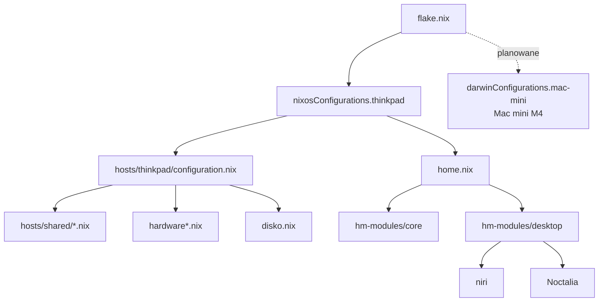

# NixOS — ThinkPad T490

Osobista konfiguracja NixOS oparta o **flake**, **Home Managera**, **niri** i **Noctalię**.
Obecnie jeden host: `thinkpad` (Linux), użytkownik: `kamil`.
Planowane rozszerzenie: **Mac mini M4 (Darwin)**.

[](https://nixos.org/)
[](https://github.com/YaLTeR/niri)
[](https://noctalia.dev/)

## Stack technologiczny

| Warstwa | Technologia |
|---|---|
| System | [NixOS](https://nixos.org/) `nixos-unstable` |
| Zarządzanie | [Nix flakes](https://nix.dev/concepts/flakes) |
| Środowisko użytkownika | [Home Manager](https://github.com/nix-community/home-manager) |
| Kompozytor | [niri](https://github.com/YaLTeR/niri) |
| Shell / UI | [Noctalia](https://noctalia.dev/) |
| Bootloader | systemd-boot |
| System plików | btrfs; LUKS przygotowany pod przyszłą reinstalację |
| Formatowanie | [alejandra](https://github.com/kamadorueda/alejandra) |
| Planowany host | [nix-darwin](https://github.com/LnL7/nix-darwin) + Home Manager (Mac mini M4) |

## Mapa repozytorium

```text
.
├── flake.nix                    # wejścia i definicja hosta
├── flake.lock
├── home.nix                     # konfiguracja Home Managera
├── Makefile                     # update / test / check / fmt / Noctalia
├── hosts/
│   ├── shared/
│   │   ├── system.nix           # boot, sieć, Nix, Tailscale
│   │   ├── users.nix            # konto użytkownika
│   │   └── desktop.nix          # niri, Noctalia, greeter, audio, locale
│   └── thinkpad/
│       ├── configuration.nix    # punkt wejścia hosta
│       ├── hardware.nix         # GPU, fwupd, T490
│       ├── hardware-configuration.nix
│       ├── disko.nix            # docelowy układ LUKS + btrfs
│       └── INSTALL.md           # instrukcja reinstalacji z LUKS
├── hm-modules/
│   ├── default.nix
│   ├── core/                    # fish, git, direnv, GTK, Zed, Neovim...
│   └── desktop/
│       ├── niri/                # input, layout, outputs, binds
│       └── noctalia/            # motyw, szablony GTK, snapshot GUI
└── scripts/
    └── noctalia-export.sh       # eksport ustawień GUI do repo
```

## Schemat konfiguracji



## Szybki start

```console
make update    # nixos-rebuild switch
make test      # nixos-rebuild test, bez zmiany generacji
make check     # nix flake check --no-build
make fmt       # alejandra
make clean     # GC systemu i użytkownika
```

Host można podmienić przez `HOST`:

```console
make update HOST=thinkpad
```

## Noctalia — trzy warstwy configu

| Plik | Rola |
|---|---|
| `programs.noctalia.settings` → `~/.config/noctalia/config.toml` | bazowa konfiguracja z Nixa, m.in. szablony GTK |
| `hm-modules/desktop/noctalia/gui.toml` → `~/.config/noctalia/gui.toml` | snapshot ustawień z GUI, wersjonowany w repo |
| `~/.local/state/noctalia/settings.toml` | bieżące nadpisania zapisywane przez GUI; **ma pierwszeństwo** |

Po zmianach w GUI aktualizujesz snapshot:

```console
make noctalia-export
git diff hm-modules/desktop/noctalia/gui.toml
```

Snapshot generuje [`scripts/noctalia-export.sh`](scripts/noctalia-export.sh), uruchamiany przez `make noctalia-export`.

Szczegóły: [Noctalia docs](https://docs.noctalia.dev/noctalia/configuration/).

## Skróty klawiszowe

`Mod` = Super. Pełna lista: [`hm-modules/desktop/niri/binds.nix`](hm-modules/desktop/niri/binds.nix).

### Uruchamianie i Noctalia

| Skrót | Akcja |
|---|---|
| `Mod+T` | terminal (kitty) |
| `Mod+Space` | launcher Noctalii |
| `Mod+E` | pliki (Nautilus) |
| `Mod+W` | Brave Origin |
| `Mod+S` | Spotify |
| `Mod+P` | menu sesji / power |
| `Mod+Alt+K` | kalendarz |
| `Mod+Alt+L` | lockscreen |
| `Mod+Shift+A` | audio |
| `Mod+Shift+B` | Bluetooth |
| `Mod+Shift+D` | dark / light |
| `Mod+Shift+M` | media |
| `Mod+Shift+N` | powiadomienia |
| `Mod+Shift+P` | power / bateria |
| `Mod+Shift+S` | ustawienia Noctalii |
| `Mod+Shift+V` | schowek |
| `Mod+Shift+W` | tapety |
| `Mod+Shift+Y` | pogoda |
| `Mod+Shift+Print` | screenshot regionu |
| `Mod+Ctrl+Print` | screenshot okna |

### Okna

| Skrót | Akcja |
|---|---|
| `Mod+Q` | zamknij okno |
| `Mod+Shift+E` | wyjdź z niri |
| `Mod+Left/Right/Up/Down` | fokus |
| `Mod+H/J/K/L` | fokus (Vim) |
| `Mod+Ctrl+Left/Right/Up/Down` | przenieś okno / kolumnę |
| `Mod+Shift+Left/Right/Up/Down` | fokus monitora |
| `Mod+Shift+Ctrl+...` | przenieś kolumnę na monitor |
| `Mod+1…9` | obszar roboczy |
| `Mod+Ctrl+1…9` | przenieś kolumnę na obszar |
| `Mod+U` / `Mod+I` | obszar w dół / w górę |
| `Mod+Page_Down` / `Mod+Page_Up` | obszar w dół / w górę |
| `Mod+F` | maksymalizacja kolumny |
| `Mod+Shift+F` | pełny ekran |
| `Mod+V` | toggle floating |
| `Mod+Shift+Space` | toggle floating (alias) |
| `Mod+Alt+V` | fokus floating ↔ tiling |
| `Mod+R` | zmiana szerokości kolumny |
| `Mod+Minus` / `Mod+Equal` | szerokość −10% / +10% |
| `Mod+Shift+Minus` / `Mod+Shift+Equal` | wysokość −10% / +10% |
| `Mod+C` | wyśrodkuj kolumnę |
| `Mod+Tab` | tryb tabbed |
| `Mod+O` | overview |
| `Mod+Shift+Slash` | podgląd skrótów |
| `Print` | screenshot niri |

### Media

| Skrót | Akcja |
|---|---|
| `XF86AudioMicMute` | mute mikrofonu |
| `XF86AudioMute` | mute |
| `XF86AudioRaiseVolume` / `LowerVolume` | głośność |
| `XF86MonBrightnessUp` / `Down` | jasność |

## Sprzęt i reinstalacja

- `hardware.nix`: GPU Intela, fwupd, fstrim, zram, Bluetooth, UPower, power-profiles-daemon.
- `disko.nix` opisuje docelowy układ: **1G ESP + LUKS + btrfs** z `home` i `nix`.
- Obecny system korzysta z istniejącego, niezaszyfrowanego btrfs; LUKS jest przygotowany na przyszłą reinstalację.
- Pełna procedura: [`hosts/thinkpad/INSTALL.md`](hosts/thinkpad/INSTALL.md).
- Fingerprint i `fprintd` nie są używane.

## Roadmap / TODO

- [ ] Dodać hosta **Darwin**: Mac mini M4 — `hosts/darwin/` i `darwinConfigurations.mac-mini` przez [nix-darwin](https://github.com/LnL7/nix-darwin).
- [ ] Wydzielić wspólne moduły Home Managera (fish, git, direnv, Zed, Neovim, CLI) od części Linux-only (niri, Noctalia, greeter, GTK).
- [ ] Sprawdzić, które pakiety i usługi z `hosts/shared` mają sens na macOS.
- [ ] Dodać instrukcję instalacji dla macOS do README.

## Linki

- [NixOS options](https://search.nixos.org/options)
- [Home Manager options](https://home-manager-options.extranix.com/)
- [niri wiki](https://yalter.github.io/niri/)
- [Noctalia docs](https://docs.noctalia.dev/)
- [disko](https://github.com/nix-community/disko)
- [nix-direnv](https://github.com/nix-community/nix-direnv)
- [Tailscale](https://tailscale.com/)
