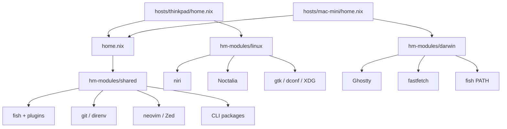

# Architecture

[← Index](../README.en.md) · [Polski](architecture.md) · English

How the flake, Home Manager and host modules fit together.

## Table of contents

- [Flake](#flake)
- [Home Manager split](#home-manager-split)
- [Host entry points](#host-entry-points)
- [State versions](#state-versions)
- [Determinate Nix](#determinate-nix)
- [Adding a host](#adding-a-host)
- [Package rules](#package-rules)
- [Verification](#verification)

## Flake

`flake.nix` exposes two system outputs and one shared formatter.

| Input | Role |
|---|---|
| `nixpkgs` (`nixos-unstable`) | packages and NixOS modules, plus nixpkgs for macOS |
| `home-manager` (`master`) | user configuration on both systems |
| `disko` | ThinkPad partitioning during reinstall |
| `nix-darwin` (`master`) | macOS system modules |
| `determinate` | Determinate Nix integration with nix-darwin |

| Output | Host |
|---|---|
| `nixosConfigurations.thinkpad` | NixOS, `x86_64-linux` |
| `darwinConfigurations.mac-mini` | macOS, `aarch64-darwin` |
| `formatter.x86_64-linux` | alejandra on the ThinkPad |
| `formatter.aarch64-darwin` | alejandra on the Mac |

## Home Manager split



The rule is simple:

- `hm-modules/shared` — works on both systems, no Wayland or Darwin
  assumptions.
- `hm-modules/linux` — niri, Noctalia, GTK/dconf, XDG user dirs, GUI packages
  from nixpkgs.
- `hm-modules/darwin` — Ghostty, fastfetch, fish PATH, macOS-specific
  packages.

This lets `nix flake check --all-systems` evaluate both hosts without trying to
build niri on macOS.

## Host entry points

| File | Role |
|---|---|
| `hosts/thinkpad/configuration.nix` | imports `hosts/shared`, hardware and disko; sets the hostname |
| `hosts/thinkpad/home.nix` | shared base + `hm-modules/linux`, per-host home directory |
| `hosts/mac-mini/configuration.nix` | `hostPlatform`, `stateVersion = 7`, `primaryUser`, fish, fonts |
| `hosts/mac-mini/homebrew.nix` | casks and brews |
| `hosts/mac-mini/defaults.nix` | `system.defaults`, Gatekeeper, keyboard |
| `hosts/mac-mini/home.nix` | shared base + `hm-modules/darwin`, per-host home directory |

Home Manager is wired in as a system module:

- NixOS: `home-manager.nixosModules.home-manager`
- macOS: `home-manager.darwinModules.home-manager`

Both use `useGlobalPkgs = true` and `useUserPackages = true`, so HM packages go
into the system-managed user profile.

## State versions

| Setting | Value | Note |
|---|---|---|
| `system.stateVersion` (NixOS) | `"26.05"` | in `hosts/thinkpad/configuration.nix` |
| `home.stateVersion` | `"26.05"` | in the shared `home.nix` |
| `system.stateVersion` (nix-darwin) | `7` | **integer**, not `"26.05"` |

Do not bump `stateVersion` without a reason — it is not the system version
number.

## Determinate Nix

On macOS, Nix is managed by Determinate, not nix-darwin. The flake has a
`determinate` input, and the host modules import
`determinate.darwinModules.default`. The module sets `nix.enable = false`, so:

- `nix.settings`, `nix.gc` and `nix.optimise` are not used,
- Nix configuration goes through `determinateNix.customSettings`,
- GC and the builder are managed by `determinate-nixd`.

The ThinkPad still runs upstream Nix through NixOS.

## Adding a host

1. Create `hosts/<name>/`.
2. Add `configuration.nix` (system entry point).
3. Add `home.nix` importing `../../home.nix` and the right platform module.
4. Add a `nixosConfigurations.<name>` or `darwinConfigurations.<name>` output
   in `flake.nix`.
5. Set `homeDirectory` in `hosts/<name>/home.nix`.
6. Run `nix flake check --all-systems`.

## Package rules

- **CLI → nixpkgs.** `ripgrep`, `fd`, `bat`, `yazi`, `lazygit`, `ffmpeg`, etc.
- **GUI → casks on macOS.** Spotify, Discord, VS Code, Obsidian, etc.
- **Do not duplicate.** If something is in `shared/packages.nix`, do not add
  the same tool to `homebrew.brews`.
- **Nix is the source of truth.** Manual `brew install` packages outside the
  list are caught by `cleanup = "check"`.

## Verification

```console
# on the ThinkPad
nix flake check --no-build
sudo nixos-rebuild build --flake .#thinkpad

# on the Mac
nix flake check --no-build
darwin-rebuild build --flake .#mac-mini
```

`--all-systems` checks both hosts from either machine:

```console
nix flake check --no-build --all-systems
```
