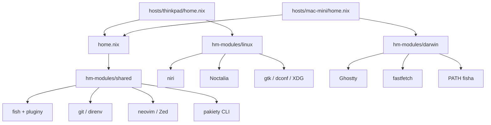

# Architektura

[← Index](../README.md) · **Polski** · [English](architecture.en.md)

Jak flake, Home Manager i moduły hostów składają się w całość.

## Spis treści

- [Flake](#flake)
- [Podział Home Managera](#podział-home-managera)
- [Punkty wejścia hostów](#punkty-wejścia-hostów)
- [Wersje stanu](#wersje-stanu)
- [Determinate Nix](#determinate-nix)
- [Dodawanie hosta](#dodawanie-hosta)
- [Zasady pakietów](#zasady-pakietów)
- [Weryfikacja](#weryfikacja)

## Flake

`flake.nix` ma dwa wyjścia systemowe i jedno wspólne narzędzie formatujące.

| Input | Rola |
|---|---|
| `nixpkgs` (`nixos-unstable`) | pakiety i moduły NixOS oraz nixpkgs dla macOS |
| `home-manager` (`master`) | konfiguracja użytkownika na obu systemach |
| `disko` | partycjonowanie ThinkPada przy reinstalacji |
| `nix-darwin` (`master`) | moduły systemowe macOS |
| `determinate` | integracja Determinate Nix z nix-darwin |

| Output | Host |
|---|---|
| `nixosConfigurations.thinkpad` | NixOS, `x86_64-linux` |
| `darwinConfigurations.mac-mini` | macOS, `aarch64-darwin` |
| `formatter.x86_64-linux` | alejandra na ThinkPadzie |
| `formatter.aarch64-darwin` | alejandra na Macu |

## Podział Home Managera



Zasada jest prosta:

- `hm-modules/shared` — działa na obu systemach, bez założeń o Waylandzie
  ani o Darwinie.
- `hm-modules/linux` — niri, Noctalia, GTK/dconf, polskie katalogi XDG,
  pakiety GUI z nixpkgs.
- `hm-modules/darwin` — Ghostty, fastfetch, PATH dla fisha, pakiety
  specyficzne dla macOS.

Dzięki temu `nix flake check --all-systems` może wyewaluować oba hosty bez
prób budowania niri na macOS.

## Punkty wejścia hostów

| Plik | Rola |
|---|---|
| `hosts/thinkpad/configuration.nix` | importuje `hosts/shared`, hardware i disko; ustawia hostname |
| `hosts/thinkpad/home.nix` | wspólna baza + `hm-modules/linux`, katalog domowy per host |
| `hosts/mac-mini/configuration.nix` | `hostPlatform`, `stateVersion = 7`, `primaryUser`, fish, fonty |
| `hosts/mac-mini/homebrew.nix` | casks i brews |
| `hosts/mac-mini/defaults.nix` | `system.defaults`, Gatekeeper, klawiatura |
| `hosts/mac-mini/home.nix` | wspólna baza + `hm-modules/darwin`, katalog domowy per host |

Home Manager jest podłączony jako moduł systemowy:

- NixOS: `home-manager.nixosModules.home-manager`
- macOS: `home-manager.darwinModules.home-manager`

W obu przypadkach `useGlobalPkgs = true` i `useUserPackages = true`, więc
pakiety HM trafiają do profilu użytkownika zarządzanego przez system.

## Wersje stanu

| Ustawienie | Wartość | Uwaga |
|---|---|---|
| `system.stateVersion` (NixOS) | `"26.05"` | w `hosts/thinkpad/configuration.nix` |
| `home.stateVersion` | `"26.05"` | we wspólnym `home.nix` |
| `system.stateVersion` (nix-darwin) | `7` | **integer**, nie `"26.05"` |

Nie podnoś `stateVersion` bez powodu — to nie jest numer wersji systemu.

## Determinate Nix

Na Macu Nixem zarządza Determinate, a nie nix-darwin. W flake jest input
`determinate`, a w modułach hosta `determinate.darwinModules.default`.
Moduł ustawia `nix.enable = false`, więc:

- nie używamy `nix.settings`, `nix.gc` ani `nix.optimise`,
- konfiguracja Nixa idzie przez `determinateNix.customSettings`,
- GC i builder są zarządzane przez `determinate-nixd`.

Na ThinkPadzie nadal działa upstream Nix z NixOS.

## Dodawanie hosta

1. Utwórz katalog `hosts/<nazwa>/`.
2. Dodaj `configuration.nix` (punkt wejścia systemu).
3. Dodaj `home.nix` importujący `../../home.nix` i właściwy moduł platformy.
4. W `flake.nix` dodaj output `nixosConfigurations.<nazwa>` albo
   `darwinConfigurations.<nazwa>`.
5. Ustaw `homeDirectory` w `hosts/<nazwa>/home.nix`.
6. Uruchom `nix flake check --all-systems`.

## Zasady pakietów

- **CLI → nixpkgs.** `ripgrep`, `fd`, `bat`, `yazi`, `lazygit`, `ffmpeg` itd.
- **GUI → casks na macOS.** Spotify, Discord, VS Code, Obsidian itd.
- **Nie duplikuj.** Jeśli coś jest w `shared/packages.nix`, nie dodawaj tego
  samego do `homebrew.brews`.
- **Nix jest źródłem prawdy.** Ręczne `brew install` spoza listy będzie
  widoczne przy `cleanup = "check"`.

## Weryfikacja

```console
# na ThinkPadzie
nix flake check --no-build
sudo nixos-rebuild build --flake .#thinkpad

# na Macu
nix flake check --no-build
darwin-rebuild build --flake .#mac-mini
```

`--all-systems` na dowolnej maszynie sprawdza oba hosty:

```console
nix flake check --no-build --all-systems
```
