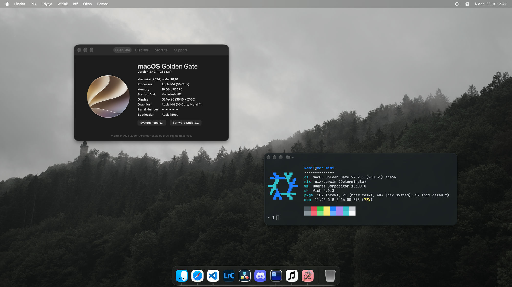
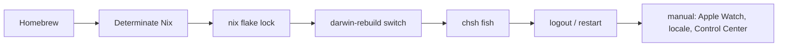

# Mac mini M4 — nix-darwin

[← Index](../../README.en.md) · [Polski](README.md) · English

Mac mini M4 (Apple Silicon), macOS 27, Determinate Nix + nix-darwin + Home
Manager. This document describes a **fresh install** and day-to-day
maintenance.



## Table of contents

- [Overview](#overview)
- [Fresh install](#fresh-install)
- [What is managed](#what-is-managed)
- [Homebrew: casks, brews and cleanup](#homebrew-casks-brews-and-cleanup)
- [Manual app installation](#manual-app-installation)
- [macOS defaults](#macos-defaults)
- [Wallpapers](#wallpapers)
- [Fish, Ghostty, fastfetch](#fish-ghostty-fastfetch)
- [Maintenance](#maintenance)
- [Troubleshooting](#troubleshooting)
- [Configuration check](#configuration-check)
- [Links](#links)

## Overview

| Item | Value |
|---|---|
| Hardware | Mac mini M4, `aarch64-darwin` |
| System | macOS 27 |
| Nix | Determinate Nix (`determinate-nixd`) |
| Management | nix-darwin + Home Manager |
| `system.stateVersion` | `7` (integer, not `"26.05"`) |
| GUI | Homebrew casks |
| CLI | nixpkgs + a few brews |
| Terminal | Ghostty + fish |

## Fresh install

> Assumes a clean macOS, an administrator account and internet access.
> Run everything below as your user, not as root.



### 1. Prerequisites

Optional, but useful for some builds:

```console
xcode-select --install
```

### 2. Homebrew

nix-darwin **does not install Homebrew** — it only manages it. Install it first
(Apple Silicon → `/opt/homebrew`):

```console
/bin/bash -c "$(curl -fsSL https://raw.githubusercontent.com/Homebrew/install/HEAD/install.sh)"
```

Add brew to zsh (fish gets integration later from nix-darwin):

```console
echo 'eval "$(/opt/homebrew/bin/brew shellenv zsh)"' >> ~/.zprofile
eval "$(/opt/homebrew/bin/brew shellenv zsh)"
brew --version
```

### 3. Determinate Nix

```console
curl -fsSL https://install.determinate.systems/nix | sh -s -- install
```

Open a new terminal and check:

```console
nix --version
```

### 4. Repository

```console
git clone <repo-url> ~/Documents/NixOS
cd ~/Documents/NixOS
```

### 5. Populate the lockfile

The repo uses `nix-darwin` and `determinate`, so the first run has to add them
to `flake.lock`:

```console
nix flake lock
```

### 6. First switch

```console
sudo nix run nix-darwin/master#darwin-rebuild -- switch --flake .#mac-mini
```

If `sudo` cannot find `nix`:

```console
sudo /nix/var/nix/profiles/default/bin/nix run \
  nix-darwin/master#darwin-rebuild -- switch --flake .#mac-mini
```

The first switch takes a while — it downloads nixpkgs, casks and builds the
profile.

### 7. Fish as the login shell

```console
chsh -s /run/current-system/sw/bin/fish
```

### 8. Log out and back in

This finalizes settings that processes read at startup: dark mode, accent
color, Liquid Glass, and parts of Finder/Control Center.

### 9. macOS permissions

The first `darwin-rebuild` may show TCC dialogs. If needed:

- **Full Disk Access** for the terminal/Ghostty if `darwin-rebuild` changes
  protected user files.

### 10. Manual steps (outside Nix)

| What | Where |
|---|---|
| Apple Watch unlock | System Settings → Login Password → Apple Watch |
| Polish keyboard layout | System Settings → Keyboard |
| Locale / region | System Settings → General → Language & Region |
| Control Center order and sizes | System Settings → Menu Bar / Control Center |
| “Show When Active” for Focus/Mirroring/Display/Sound/Now Playing | System Settings → Menu Bar |
| Menu bar timer | System Settings → Menu Bar (if available) |
| Apps outside Nix | [Manual app installation](#manual-app-installation) |
| FileVault | System Settings → Privacy & Security |

Apple Watch unlock requires the same Apple Account, 2FA, Wi-Fi/BT and a watch
passcode. It is key pairing, not a plain preference — that is why it is not in
`defaults`.

### 11. Verification

```console
darwin-version
fish --version
fastfetch
brew list --cask | wc -l
spctl --status
defaults read -g NSGlassTintAmount
```

## What is managed

| File | Contents |
|---|---|
| `hosts/mac-mini/configuration.nix` | `hostPlatform`, `stateVersion = 7`, hostname, `primaryUser`, fish, fonts, system packages |
| `hosts/mac-mini/home.nix` | Home Manager + `hm-modules/darwin` |
| `hosts/mac-mini/homebrew.nix` | casks and brews, `onActivation.cleanup` |
| `hosts/mac-mini/defaults.nix` | `system.defaults`, Gatekeeper, keyboard |
| `hm-modules/darwin/default.nix` | fish PATH |
| `hm-modules/darwin/ghostty.nix` | Ghostty configuration |
| `hm-modules/darwin/fastfetch.nix` | symlink to the fastfetch config |
| `hm-modules/darwin/fastfetch.jsonc` | `macos_small` logo, OS/CPU/RAM/disk modules |
| `home.nix` (root) | shared HM base: username, stateVersion, shared |

## Homebrew: casks, brews and cleanup

```nix
homebrew = {
  enable = true;
  enableFishIntegration = true;
  onActivation = {
    cleanup = "none";
    autoUpdate = false;
    upgrade = false;
  };
};
```

### Casks

<details>
<summary>Full list</summary>

`android-platform-tools`, `appcleaner`, `betterdisplay`, `bitwarden`,
`brave-browser`, `discord`, `ghostty`, `google-chrome`, `handbrake-app`,
`keka`, `lunar-client`, `macusb`, `obs`, `obsidian`, `opencode-desktop`,
`prismlauncher`, `protonvpn`, `sanesidebuttons`, `steam`,
`visual-studio-code`, `whatsapp`.

</details>

### Brews

`f3`, `gh`, `mpv`, `nmap`, `node`, `uv`.

The remaining CLI tools (`bat`, `eza`, `fastfetch`, `fish`, `fzf`, `lazygit`,
`zoxide`) come from Nix.

### `onActivation.cleanup`

| Value | Behaviour |
|---|---|
| `"none"` | Leaves packages outside the Brewfile alone. **Current setting.** |
| `"check"` | Verifies that no packages/taps exist outside the Brewfile. If any are found, it **aborts activation** and prints the list. It removes nothing. |
| `"uninstall"` | Removes packages outside the Brewfile (`brew uninstall`). |
| `"zap"` | Removes packages and cask leftovers. **Warning:** combined with `masApps` it can remove every App Store app. |

`"check"` is drift verification, not cleanup. Enable it **after the list is
stable** (or on a clean machine), because it:

- catches manual `brew install` packages outside the repo,
- catches stale casks and taps,
- catches dependencies orphaned by packages outside the Brewfile,
- on failure **aborts the whole switch**, so other changes do not apply either.

## Manual app installation

These apps are not in Nix or casks — install them yourself:

| App | Source |
|---|---|
| Adobe Lightroom | Adobe Creative Cloud |
| Microsoft Office LTSC (Word, Excel, PowerPoint; Access only in a Windows VM) | Microsoft 365 admin center / VLSC |
| Amphetamine | App Store |
| uBlock Origin Lite | App Store |
| Nicotine+ | manual |
| DisableCtrlClick | manual |
| Python 3.14 | python.org |

App Store requires an Apple ID, Office requires a valid VL agreement, and
Lightroom requires an Adobe account.

## macOS defaults

Managed in `hosts/mac-mini/defaults.nix`.

| Setting | Key / effect |
|---|---|
| Dock at the bottom, no autohide | `orientation = "bottom"`, `autohide = false` |
| Size / magnification | `tilesize = 55` (35%), `largesize = 61` (40%), `magnification = true` |
| Genie minimize effect | `mineffect = "genie"` |
| Double-click title bar: fill | `AppleActionOnDoubleClick = "Maximize"` |
| No recent/suggested apps | `show-recents = false` |
| Top-left hot corner | `wvous-tl-corner = 2` + `wvous-tl-modifier = 0` |
| Finder: extensions, folders first | `AppleShowAllExtensions`, `_FXSortFoldersFirst` |
| Finder: search current folder | `FXDefaultSearchScope = "SCcf"` |
| Finder: Cmd+Q | `QuitMenuItem = true` |
| Desktop icons hidden, revealed on click | `WindowManager.StandardHideDesktopIcons = true` + `EnableStandardClickToShowDesktop = true` |
| Dark mode | `AppleInterfaceStyle = "Dark"` |
| Graphite accent | `AppleAccentColor = -1` |
| Liquid Glass ~75% | `NSGlassTintAmount = 0.75` |
| Key repeat | `KeyRepeat = 2`, `InitialKeyRepeat = 15` |
| No text autocorrection | `NSAutomatic* = false` (6 keys) |
| Screenshots to clipboard | `screencapture.target = "clipboard"` |
| Caps Lock → Escape | `system.keyboard` |
| Gatekeeper “anywhere” | activation: `spctl --global-disable` |

### What requires manual work

- **Apple Watch unlock** — pairing, not `defaults`.
- **Control Center** — order, sizes and some “Show When Active” values live in
  macOS 27 binary blobs (`BentoBoxCustomizationState`, `bentoboxes.*.plist`).
  nix-darwin does not manage them.
- **Menu bar** — Focus, Screen Mirroring, Display, Sound, Now Playing, Timer:
  no stable key; set manually.
- **Locale and Polish keyboard** — `com.apple.HIToolbox` is not managed.
- **App Store** — `masApps` is not used; sign-in and purchases are manual.

### Refresh behaviour

- Dock is restarted by `darwin-rebuild` — changes are visible immediately.
- Finder: `killall Finder`.
- Dark mode, accent, Liquid Glass — log out.
- Manual slider changes are overwritten by the next switch for keys managed by
  Nix.

> `spctl --global-disable` disables app assessment (“Anywhere”). This is a
> deliberate security trade-off. macOS 27 no longer has `--master-disable`.

## Wallpapers

[revaljonathan/wallpapers](https://github.com/revaljonathan/wallpapers)

## Fish, Ghostty, fastfetch

- Fish and plugins: [docs/fish.en.md](../../docs/fish.en.md).
- Ghostty: SF Mono 13 + JetBrains Nerd Font fallback, fixed dark scheme
  (#1f2428 background), frosted glass, padding 12.
- Fastfetch: `hm-modules/darwin/fastfetch.jsonc`, `macos_small` logo.

> `macos-option-as-alt = true` in Ghostty takes Option away for Alt. Polish
> characters (`Option+a`, etc.) will not work in the terminal. If you need
> them, use `macos-option-as-alt = "left"`.

## Maintenance

```console
make mac           # darwin-rebuild switch
make mac-build     # build only
make mac-rollback  # previous generation
make check-all     # nix flake check --all-systems
```

Update inputs:

```console
nix flake update
nix flake lock
```

Determinate Nix updates outside the flake:

```console
sudo determinate-nixd upgrade
determinate-nixd version
```

GC is automatic (Determinate keeps ~30 GB / 5–20% free). `nix.gc` and
`nix.settings` are disabled because `nix.enable = false`.

## Troubleshooting

**`sudo: nix: command not found`**
Use the full path:

```console
sudo /nix/var/nix/profiles/default/bin/nix run \
  nix-darwin/master#darwin-rebuild -- switch --flake .#mac-mini
```

**`brew: command not found`**
Homebrew is not installed by nix-darwin. Install it and add `brew shellenv` to
zsh.

**`cleanup = "check"` aborts the switch**
That is intentional. It prints packages/taps outside the Brewfile. Add them to
`homebrew.nix` or remove them from brew.

**`flake.lock` is missing inputs**
After changing `flake.nix`:

```console
nix flake lock
```

**Fish is not the login shell**
Check `/etc/shells` and run
`chsh -s /run/current-system/sw/bin/fish`. `environment.shells` in
`configuration.nix` adds fish there.

**Defaults do not apply**
Dock restarts automatically; Finder needs `killall Finder`; dark mode, accent,
and Liquid Glass need a logout.

## Configuration check

Is everything in git:

```console
git status --short
git ls-files --others --exclude-standard
```

Untracked `??` files are invisible to the flake — add them before testing:

```console
git add -A
```

Evaluate both hosts:

```console
nix flake lock
nix flake check --no-build --all-systems
```

Build the Mac:

```console
darwin-rebuild build --flake .#mac-mini
```

If `darwin-rebuild` is not in `PATH` yet (before the first switch):

```console
sudo nix run nix-darwin/master#darwin-rebuild -- build --flake .#mac-mini
```

The ThinkPad builds on the ThinkPad:

```console
sudo nixos-rebuild build --flake .#thinkpad
```

## Links

- [nix-darwin options](https://nix-darwin.github.io/nix-darwin/manual/)
- [Determinate Nix](https://docs.determinate.systems/determinate-nix/)
- [Home Manager options](https://home-manager-options.extranix.com/)
- [Ghostty config](https://ghostty.org/docs/config)
- [Homebrew casks](https://formulae.brew.sh/cask/)
- [Apple: Appearance settings](https://support.apple.com/guide/mac-help/change-appearance-settings-mchlp1225/mac)
