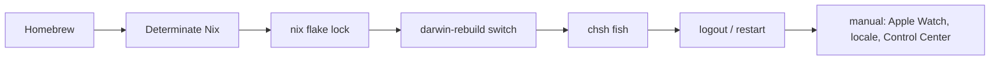

# Mac mini M4 — nix-darwin

[← Wróć do indexu](../../README.md) · **Polski** · [English](README.en.md)

Mac mini M4 (Apple Silicon), macOS 27, Determinate Nix + nix-darwin + Home
Manager. Ten dokument opisuje **instalację od zera** i utrzymanie maszyny.

## Spis treści

- [Przegląd](#przegląd)
- [Instalacja od zera](#instalacja-od-zera)
- [Co jest zarządzane](#co-jest-zarządzane)
- [Homebrew: casks, brews i cleanup](#homebrew-casks-brews-i-cleanup)
- [Ręczna instalacja aplikacji](#ręczna-instalacja-aplikacji)
- [macOS defaults](#macos-defaults)
- [Tapety](#tapety)
- [Fish, Ghostty, fastfetch](#fish-ghostty-fastfetch)
- [Utrzymanie](#utrzymanie)
- [Troubleshooting](#troubleshooting)
- [Sprawdzenie konfiguracji](#sprawdzenie-konfiguracji)
- [Linki](#linki)

## Przegląd

| Element | Wartość |
|---|---|
| Sprzęt | Mac mini M4, `aarch64-darwin` |
| System | macOS 27 |
| Nix | Determinate Nix (`determinate-nixd`) |
| Zarządzanie | nix-darwin + Home Manager |
| `system.stateVersion` | `7` (integer, nie `"26.05"`) |
| GUI | Homebrew casks |
| CLI | nixpkgs + kilka brews |
| Terminal | Ghostty + fish |

## Instalacja od zera

> Zakładamy czysty macOS, konto administratora i dostęp do internetu.
> Wszystko poniżej wykonujesz jako swój użytkownik, nie jako root.



### 1. Wymagania wstępne

Opcjonalnie, ale przydatne dla niektórych buildów:

```console
xcode-select --install
```

### 2. Homebrew

nix-darwin **nie instaluje Homebrew** — tylko nim zarządza. Zainstaluj je
najpierw (Apple Silicon → `/opt/homebrew`):

```console
/bin/bash -c "$(curl -fsSL https://raw.githubusercontent.com/Homebrew/install/HEAD/install.sh)"
```

Dodaj brew do zsh (fish dostanie integrację później z nix-darwin):

```console
echo 'eval "$(/opt/homebrew/bin/brew shellenv zsh)"' >> ~/.zprofile
eval "$(/opt/homebrew/bin/brew shellenv zsh)"
brew --version
```

### 3. Determinate Nix

```console
curl -fsSL https://install.determinate.systems/nix | sh -s -- install
```

Otwórz nowy terminal i sprawdź:

```console
nix --version
```

### 4. Repozytorium

```console
git clone <adres-repo> ~/Documents/NixOS
cd ~/Documents/NixOS
```

### 5. Uzupełnij lockfile

Repo używa `nix-darwin` i `determinate`, więc pierwszy raz trzeba je dopisać
do `flake.lock`:

```console
nix flake lock
```

### 6. Pierwszy switch

```console
sudo nix run nix-darwin/master#darwin-rebuild -- switch --flake .#mac-mini
```

Jeśli `sudo` nie widzi `nix`:

```console
sudo /nix/var/nix/profiles/default/bin/nix run \
  nix-darwin/master#darwin-rebuild -- switch --flake .#mac-mini
```

Pierwszy switch może potrwać — pobiera Nixa, casks i buduje profil.

### 7. Fish jako powłoka logowania

```console
chsh -s /run/current-system/sw/bin/fish
```

### 8. Wyloguj się i zaloguj ponownie

To domyka ustawienia, które procesy czytają przy starcie: dark mode, akcent,
Liquid Glass, akceleracja myszy, część Finder/Control Center.

### 9. Uprawnienia macOS

Przy pierwszym `darwin-rebuild` mogą pojawić się dialogi TCC. W razie potrzeby:

- **Full Disk Access** dla terminala/Ghostty, jeśli `darwin-rebuild` zmienia
  chronione pliki użytkownika.

### 10. Kroki ręczne (poza Nixem)

| Co | Gdzie |
|---|---|
| Apple Watch unlock | System Settings → Login Password → Apple Watch |
| Układ klawiatury PL | System Settings → Keyboard |
| Locale / region | System Settings → General → Language & Region |
| Kolejność i rozmiary Control Center | System Settings → Menu Bar / Control Center |
| „Show When Active” dla Focus/Mirroring/Display/Sound/Now Playing | System Settings → Menu Bar |
| Timer w menu barze | System Settings → Menu Bar (jeśli dostępny) |
| Aplikacje poza Nixem | [Ręczna instalacja aplikacji](#ręczna-instalacja-aplikacji) |
| FileVault | System Settings → Privacy & Security |

Apple Watch unlock wymaga tego samego Apple Account, 2FA, Wi-Fi/BT i kodu na
zegarku. To parowanie kluczy, nie zwykły preference — dlatego nie ma tego
w `defaults`.

### 11. Weryfikacja

```console
darwin-version
fish --version
fastfetch
brew list --cask | wc -l
spctl --status
defaults read -g NSGlassTintAmount
```

## Co jest zarządzane

| Plik | Zawartość |
|---|---|
| `hosts/mac-mini/configuration.nix` | `hostPlatform`, `stateVersion = 7`, hostname, `primaryUser`, fish, fonty, pakiety systemowe |
| `hosts/mac-mini/home.nix` | Home Manager + `hm-modules/darwin` |
| `hosts/mac-mini/homebrew.nix` | casks i brews, `onActivation.cleanup` |
| `hosts/mac-mini/defaults.nix` | `system.defaults`, Gatekeeper, klawiatura |
| `hm-modules/darwin/default.nix` | PATH fisha |
| `hm-modules/darwin/ghostty.nix` | konfiguracja Ghostty |
| `hm-modules/darwin/fastfetch.nix` | symlink do configu fastfetch |
| `hm-modules/darwin/fastfetch.jsonc` | logo `macos_small`, moduły OS/CPU/RAM/disk |
| `hm-modules/shared/wallpapers.nix` | tapety z repo `revaljonathan/wallpapers` |
| `home.nix` (root) | wspólna baza HM: username, stateVersion, shared |

## Homebrew: casks, brews i cleanup

```nix
homebrew = {
  enable = true;
  enableFishIntegration = true;
  onActivation = {
    cleanup = "none";
    autoUpdate = false;
    upgrade = false;
  };
};
```

### Casks

<details>
<summary>Pełna lista</summary>

`android-platform-tools`, `appcleaner`, `betterdisplay`, `bitwarden`,
`brave-browser`, `discord`, `ghostty`, `google-chrome`, `handbrake-app`,
`keka`, `lunar-client`, `macusb`, `obs`, `obsidian`, `opencode-desktop`,
`prismlauncher`, `protonvpn`, `sanesidebuttons`, `steam`,
`visual-studio-code`, `whatsapp`.

</details>

### Brews

`f3`, `gh`, `mpv`, `nmap`, `node`, `uv`.

Reszta CLI (`bat`, `eza`, `fastfetch`, `fish`, `fzf`, `lazygit`, `zoxide`)
jest z Nixa.

### `onActivation.cleanup`

| Wartość | Co robi |
|---|---|
| `"none"` | Nie rusza pakietów spoza Brewfile. **Obecne ustawienie.** |
| `"check"` | Sprawdza, czy nie ma pakietów/tapów spoza Brewfile. Jeśli są — **przerywa aktywację** i wypisuje listę. Niczego nie usuwa. |
| `"uninstall"` | Usuwa pakiety spoza Brewfile (`brew uninstall`). |
| `"zap"` | Usuwa pakiety i pozostałości po casks. **Uwaga:** w połączeniu z `masApps` potrafi usunąć wszystkie aplikacje z App Store. |

`"check"` to weryfikacja, nie sprzątanie. Warto ją włączyć **po ustabilizowaniu
listy** (albo na czystej maszynie), bo:

- wyłapuje ręczne `brew install` spoza repo,
- wyłapuje stare casks i tapy,
- wyłapuje zależności osierocone po pakietach spoza Brewfile,
- przy błędzie **przerywa cały switch**, więc inne zmiany też się nie zastosują.

## Ręczna instalacja aplikacji

Tych aplikacji nie ma w Nixie ani w casks — instalujesz je sam:

| Aplikacja | Skąd |
|---|---|
| Adobe Lightroom | Adobe Creative Cloud |
| Microsoft Office LTSC (Word, Excel, PowerPoint; Access tylko w Windows VM) | Microsoft 365 admin center / VLSC |
| Amphetamine | App Store |
| uBlock Origin Lite | App Store |
| Nicotine+ | ręcznie |
| DisableCtrlClick | ręcznie |
| Python 3.14 | python.org |

App Store wymaga Apple ID, Office — ważnej umowy VL, Lightroom — konta Adobe.

## macOS defaults

Zarządzane w `hosts/mac-mini/defaults.nix`.

| Ustawienie | Klucz / efekt |
|---|---|
| Dock na dole, bez autohide | `orientation = "bottom"`, `autohide = false` |
| Rozmiar / powiększenie | `tilesize = 55` (35%), `largesize = 61` (40%), `magnification = true` |
| Minimalizacja efektem dżina | `mineffect = "genie"` |
| Dwuklik w pasek: wypełnienie | `AppleActionOnDoubleClick = "Maximize"` |
| Bez ostatnich/sugerowanych | `show-recents = false` |
| Hot corner lewy górny | `wvous-tl-corner = 2` + `wvous-tl-modifier = 0` |
| Finder: rozszerzenia, foldery na górze | `AppleShowAllExtensions`, `_FXSortFoldersFirst` |
| Finder: szukaj w bieżącym folderze | `FXDefaultSearchScope = "SCcf"` |
| Finder: Cmd+Q | `QuitMenuItem = true` |
| Pulpit bez ikon | `CreateDesktop = false` + `WindowManager.StandardHideDesktopIcons = true` |
| Dark mode | `AppleInterfaceStyle = "Dark"` |
| Graphite accent | `AppleAccentColor = -1` |
| Liquid Glass ~75% | `NSGlassTintAmount = 0.75` |
| Key repeat | `KeyRepeat = 2`, `InitialKeyRepeat = 15` |
| Bez autokorekty tekstu | `NSAutomatic* = false` (6 kluczy) |
| Mysz bez akceleracji | `.GlobalPreferences."com.apple.mouse.scaling" = -1.0` |
| Screenshoty do schowka | `screencapture.target = "clipboard"` |
| Caps Lock → Escape | `system.keyboard` |
| Gatekeeper „wszystkie” | activation: `spctl --global-disable` |

### Co wymaga ręki

- **Apple Watch unlock** — parowanie, nie `defaults`.
- **Control Center** — kolejność, rozmiary i część „Show When Active” są
  w binarnych blobach macOS 27 (`BentoBoxCustomizationState`,
  `bentoboxes.*.plist`). nix-darwin tego nie ustawia.
- **Menu bar** — Focus, Screen Mirroring, Display, Sound, Now Playing, Timer:
  brak stabilnego klucza; ustaw ręcznie.
- **Locale i klawiatura PL** — `com.apple.HIToolbox` nie jest zarządzane.
- **App Store** — `masApps` nieużywane; logowanie i zakupy ręcznie.

### Odświeżanie

- Dock jest restartowany przez `darwin-rebuild` — zmiany widoczne od razu.
- Finder: `killall Finder`.
- Dark mode, akcent, Liquid Glass, akceleracja myszy — najlepiej wylogować się.
- Ręczna zmiana suwaka w UI zostanie nadpisana przy następnym switchu dla
  kluczy zarządzanych przez Nix.

> `spctl --global-disable` wyłącza ocenę aplikacji („Anywhere”). To świadomy
> kompromis bezpieczeństwa. Na macOS 27 nie ma już `--master-disable`.

## Tapety

Tapety pochodzą z repo
[revaljonathan/wallpapers](https://github.com/revaljonathan/wallpapers) przez
flake input `wallpapers`. Są linkowane pojedynczo do
`~/Pictures/Wallpapers`, więc wybierak tapet w System Settings widzi zwykłe
pliki, a ~800 MB nie jest kopiowane do home.

```console
nix flake update wallpapers
```

## Fish, Ghostty, fastfetch

- Fish i pluginy: [docs/fish.md](../../docs/fish.md).
- Ghostty: SF Mono 13 + JetBrains Nerd Font fallback, Catppuccin Latte/Mocha,
  frosted glass, padding 12.
- Fastfetch: `hm-modules/darwin/fastfetch.jsonc`, logo `macos_small`.

> `macos-option-as-alt = true` w Ghostty zabiera Option do Alt. Polskie znaki
> (`Option+a` itd.) nie będą działać w terminalu. Jeśli ich potrzebujesz,
> ustaw `macos-option-as-alt = "left"`.

## Utrzymanie

```console
make mac           # darwin-rebuild switch
make mac-build     # sam build
make mac-rollback  # poprzednia generacja
make check-all     # nix flake check --all-systems
```

Aktualizacja wejść:

```console
nix flake update
nix flake lock
```

Determinate Nix aktualizuje się poza flakiem:

```console
sudo determinate-nixd upgrade
determinate-nixd version
```

GC jest automatyczny (Determinate trzyma ok. 30 GB / 5–20% wolnego miejsca).
`nix.gc` i `nix.settings` są wyłączone, bo `nix.enable = false`.

## Troubleshooting

**`sudo: nix: command not found`**
Użyj pełnej ścieżki:

```console
sudo /nix/var/nix/profiles/default/bin/nix run \
  nix-darwin/master#darwin-rebuild -- switch --flake .#mac-mini
```

**`brew: command not found`**
Homebrew nie jest instalowane przez nix-darwin. Zainstaluj je i dodaj
`brew shellenv` do zsh.

**`cleanup = "check"` przerywa switch**
To zamierzone. Wypisze pakiety/tapy spoza Brewfile. Dodaj je do
`homebrew.nix` albo usuń z brew.

**`flake.lock` nie ma inputów**
Po zmianie `flake.nix`:

```console
nix flake lock
```

**Fish nie jest powłoką logowania**
Sprawdź `/etc/shells` i wykonaj `chsh -s /run/current-system/sw/bin/fish`.
`environment.shells` w `configuration.nix` dodaje tam fisha.

**Defaults nie działają**
Dock restartuje się sam; Finder wymaga `killall Finder`; dark mode, akcent,
Liquid Glass i mysz — wylogowania.

## Sprawdzenie konfiguracji

Czy wszystko jest w gicie:

```console
git status --short
git ls-files --others --exclude-standard
```

Pliki `??` nie są widoczne dla flake'a — dodaj je przed testem:

```console
git add -A
```

Ewaluacja obu hostów:

```console
nix flake lock
nix flake check --no-build --all-systems
```

Build Maca:

```console
darwin-rebuild build --flake .#mac-mini
```

Jeśli `darwin-rebuild` nie ma jeszcze w `PATH` (przed pierwszym switchem):

```console
sudo nix run nix-darwin/master#darwin-rebuild -- build --flake .#mac-mini
```

ThinkPad buduje się na ThinkPadzie:

```console
sudo nixos-rebuild build --flake .#thinkpad
```

## Linki

- [nix-darwin options](https://nix-darwin.github.io/nix-darwin/manual/)
- [Determinate Nix](https://docs.determinate.systems/determinate-nix/)
- [Home Manager options](https://home-manager-options.extranix.com/)
- [Ghostty config](https://ghostty.org/docs/config)
- [Homebrew casks](https://formulae.brew.sh/cask/)
- [Apple: zmiana ustawień Appearance](https://support.apple.com/guide/mac-help/change-appearance-settings-mchlp1225/mac)
