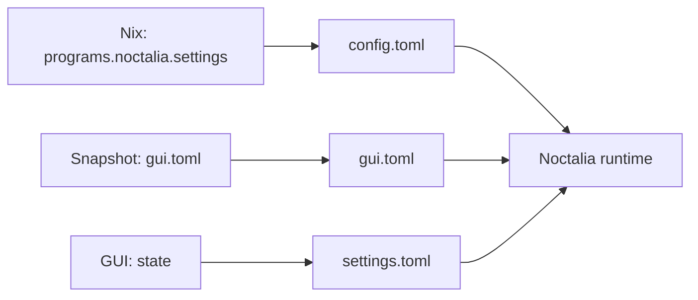

# ThinkPad T490 — NixOS

[← Wróć do indexu](../../README.md) · **Polski** · [English](README.en.md)

ThinkPad T490 z NixOS `nixos-unstable`, niri jako kompozytorem i Noctalią
jako shellem. Konfiguracja korzysta ze wspólnego Home Managera i modułów
`hosts/shared`.

## Spis treści

- [Konfiguracja hosta](#konfiguracja-hosta)
- [Instalacja i reinstalacja](#instalacja-i-reinstalacja)
- [Desktop: niri + Noctalia](#desktop-niri--noctalia)
- [Tapety](#tapety)
- [Skróty klawiszowe](#skróty-klawiszowe)
- [Sprzęt i energia](#sprzęt-i-energia)
- [Utrzymanie](#utrzymanie)
- [Troubleshooting](#troubleshooting)
- [Linki](#linki)

## Konfiguracja hosta

| Plik | Rola |
|---|---|
| `hosts/thinkpad/configuration.nix` | punkt wejścia: importy, hostname, `stateVersion` |
| `hosts/thinkpad/home.nix` | HM: `hm-modules/linux` + katalog domowy Linuksa |
| `hosts/thinkpad/hardware.nix` | GPU Intela, fwupd, fstrim, zram, Bluetooth, UPower |
| `hosts/thinkpad/hardware-configuration.nix` | wygenerowany config sprzętu |
| `hosts/thinkpad/disko.nix` | docelowy układ LUKS + btrfs |
| `hosts/shared/system.nix` | boot, sieć, Tailscale, Nix, GC |
| `hosts/shared/users.nix` | konto użytkownika, pakiety systemowe |
| `hosts/shared/desktop.nix` | niri, Noctalia, greeter, audio, locale, Steam |

Podział modułów Home Managera:

- `hm-modules/shared` — fish, git, direnv, neovim, Zed, CLI.
- `hm-modules/linux` — niri, Noctalia, GTK/dconf, XDG, pakiety GUI.
- `hm-modules/darwin` — nie jest importowany na tym hoście.

## Instalacja i reinstalacja

Aktualny system korzysta z istniejącego, niezaszyfrowanego btrfs. `disko.nix`
opisuje docelowy układ:

- `nvme0n1p1` — 1G, vfat, `/boot` (ESP),
- `nvme0n1p2` — LUKS → btrfs,
- subwolumeny `home` i `nix`.

Pełna procedura z backupem, `disko` i montowaniem:
[INSTALL.md](INSTALL.md).

> `disko` w trybie `destroy,format,mount` nieodwracalnie usuwa dane z dysku.

## Desktop: niri + Noctalia

niri jest kompozytorem Wayland, a Noctalia shellem: panelem, launcherem,
powiadomieniami i lockscreenem.

Konfiguracja Noctalii ma trzy warstwy:

| Warstwa | Plik | Priorytet |
|---|---|---|
| Bazowy config z Nixa | `programs.noctalia.settings` → `~/.config/noctalia/config.toml` | najniższy |
| Snapshot z GUI w repo | `hm-modules/linux/noctalia/gui.toml` → `~/.config/noctalia/gui.toml` | średni |
| Bieżące nadpisania GUI | `~/.local/state/noctalia/settings.toml` | najwyższy |



Po zmianach w GUI zapisz snapshot:

```console
make noctalia-export
git diff hm-modules/linux/noctalia/gui.toml
```

Skrypt: [`scripts/noctalia-export.sh`](../../scripts/noctalia-export.sh).

Ważne pliki niri:

- `hm-modules/linux/niri/input.nix` — klawiatura i mysz,
- `hm-modules/linux/niri/layout.nix` — gaps, border, blur,
- `hm-modules/linux/niri/binds.nix` — skróty,
- `hm-modules/linux/niri/outputs.nix` — monitory,
- `hm-modules/linux/niri/default.nix` — window rules i include palety Noctalii.

## Tapety

Tapety są wspólne z Maciem: flake input `wallpapers` z repo
[revaljonathan/wallpapers](https://github.com/revaljonathan/wallpapers),
linkowane do `~/Pictures/Wallpapers` (pojedyncze pliki, bez kopiowania).

```console
nix flake update wallpapers
```

> Katalogi użytkownika są teraz po angielsku: `~/Downloads`, `~/Documents`,
> `~/Pictures`, `~/Videos`, `~/Music`. Stare polskie katalogi nie są
> przenoszone automatycznie — przenieś zawartość ręcznie.

## Skróty klawiszowe

`Mod` = Super. Pełna lista: [`hm-modules/linux/niri/binds.nix`](../../hm-modules/linux/niri/binds.nix).

<details>
<summary>Uruchamianie i Noctalia</summary>

| Skrót | Akcja |
|---|---|
| `Mod+T` | terminal (kitty) |
| `Mod+Space` | launcher Noctalii |
| `Mod+E` | pliki (Nautilus) |
| `Mod+W` | Brave Origin |
| `Mod+S` | Spotify |
| `Mod+P` | menu sesji / power |
| `Mod+Alt+K` | kalendarz |
| `Mod+Alt+L` | lockscreen |
| `Mod+Shift+A` | audio |
| `Mod+Shift+B` | Bluetooth |
| `Mod+Shift+D` | dark / light |
| `Mod+Shift+M` | media |
| `Mod+Shift+N` | powiadomienia |
| `Mod+Shift+P` | power / bateria |
| `Mod+Shift+S` | ustawienia Noctalii |
| `Mod+Shift+V` | schowek |
| `Mod+Shift+W` | tapety |
| `Mod+Shift+Y` | pogoda |
| `Mod+Shift+Print` | screenshot regionu |
| `Mod+Ctrl+Print` | screenshot okna |

</details>

<details>
<summary>Okna i obszary robocze</summary>

| Skrót | Akcja |
|---|---|
| `Mod+Q` | zamknij okno |
| `Mod+Shift+E` | wyjdź z niri |
| `Mod+Left/Right/Up/Down` | fokus |
| `Mod+H/J/K/L` | fokus (Vim) |
| `Mod+Ctrl+Left/Right/Up/Down` | przenieś okno / kolumnę |
| `Mod+Shift+Left/Right/Up/Down` | fokus monitora |
| `Mod+Shift+Ctrl+...` | przenieś kolumnę na monitor |
| `Mod+1…9` | obszar roboczy |
| `Mod+Ctrl+1…9` | przenieś kolumnę na obszar |
| `Mod+U` / `Mod+I` | obszar w dół / w górę |
| `Mod+Page_Down` / `Mod+Page_Up` | obszar w dół / w górę |
| `Mod+F` | maksymalizacja kolumny |
| `Mod+Shift+F` | pełny ekran |
| `Mod+V` | toggle floating |
| `Mod+Shift+Space` | toggle floating (alias) |
| `Mod+Alt+V` | fokus floating ↔ tiling |
| `Mod+R` | zmiana szerokości kolumny |
| `Mod+Minus` / `Mod+Equal` | szerokość −10% / +10% |
| `Mod+Shift+Minus` / `Mod+Shift+Equal` | wysokość −10% / +10% |
| `Mod+C` | wyśrodkuj kolumnę |
| `Mod+Tab` | tryb tabbed |
| `Mod+O` | overview |
| `Mod+Shift+Slash` | podgląd skrótów |
| `Print` | screenshot niri |

</details>

<details>
<summary>Media</summary>

| Skrót | Akcja |
|---|---|
| `XF86AudioMicMute` | mute mikrofonu |
| `XF86AudioMute` | mute |
| `XF86AudioRaiseVolume` / `LowerVolume` | głośność |
| `XF86MonBrightnessUp` / `Down` | jasność |

</details>

## Sprzęt i energia

- GPU Intela: `hardware.graphics` + `intel-media-driver`, `intel-vaapi-driver`,
  `intel-compute-runtime-legacy1` (VA-API, OpenCL).
- `zramSwap` zamiast swapu na dysku.
- `fstrim` cotygodniowo.
- `fwupd` do firmware przez LVFS.
- Bluetooth, UPower i `power-profiles-daemon`.
- Fingerprint i `fprintd` nie są używane.

## Utrzymanie

```console
make update        # nixos-rebuild switch
make test          # nixos-rebuild test
make check         # nix flake check --no-build
make fmt           # alejandra
make clean         # GC systemu i użytkownika
make noctalia-export
```

GC jest też skonfigurowany w `hosts/shared/system.nix` (`nix.gc`, cotygodniowo,
starsze niż 7 dni).

## Troubleshooting

**Kitty nie ma mojego fontu / config jest symlinkiem.**
`hm-modules/linux/kitty.nix` dopisuje `include font.conf` tylko do zwykłego
pliku. Jeśli `~/.config/kitty/kitty.conf` jest symlinkiem, aktywacja wypisze
ostrzeżenie — usuń symlink i uruchom switch ponownie.

**Noctalia nie odświeża kolorów.**
Sprawdź, czy `enable_builtin_templates = true` jest w
`hm-modules/linux/noctalia/default.nix`, i wyeksportuj snapshot.

**Zmiana nie weszła.**
`sudo nixos-rebuild switch --flake .#thinkpad` wypisze błąd ewaluacji. Szybka
weryfikacja bez budowania:

```console
nix flake check --no-build
```

## Linki

- [niri wiki](https://yalter.github.io/niri/)
- [Noctalia docs](https://docs.noctalia.dev/)
- [disko](https://github.com/nix-community/disko)
- [NixOS options](https://search.nixos.org/options)
